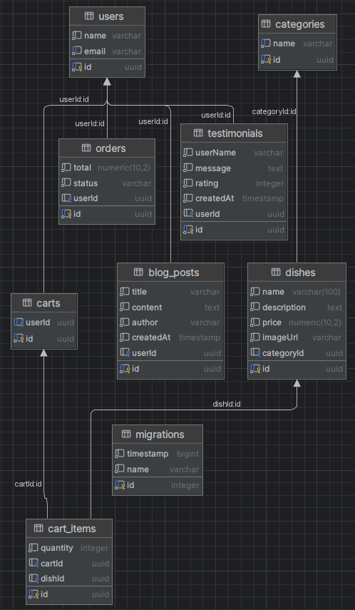

# Доменная область: Bella Pizza

Bella Pizza — это многостраничное веб-приложение для пиццерии, в котором пользователи могут просматривать меню, делать заказы, оставлять отзывы и читать статьи в блоге. Система должна обеспечивать как удобный пользовательский интерфейс, так и внутренние процессы управления данными.

---

## Поддомены

### 1. Пользователи (Users)
Поддомен управления клиентами системы.  
Пользователи регистрируются, оставляют отзывы, публикуют посты в блоге и формируют заказы через корзину.

- Каждому пользователю принадлежит **ровно одна корзина** (one-to-one).
- Пользователь может создавать **несколько постов** в блоге и оставлять **несколько отзывов**.

### 2. Меню (Menu)
Отражает ассортимент пиццерии: блюда, категории, цены и описание.

- **Dish (Блюдо)** описывает конкретную пиццу или другое блюдо.
- Блюда могут быть сгруппированы по категориям (**Category**).
- Данные меню используются при формировании корзины и заказов.

### 3. Корзина (Cart)
Виртуальная корзина покупателя, связанная с пользователем.

- Содержит список **CartItem (позиции корзины)**.
- Каждая позиция хранит выбранное блюдо и количество.
- Корзина автоматически считается из базы и хранит итоговую сумму.

### 4. Заказы (Orders)
Поддомен, отвечающий за обработку заказов, созданных из корзины.

- **Order (Заказ)** содержит информацию о пользователе, выбранных блюдах и статусе.
- **OrderItem** — конкретная позиция заказа.

### 5. Отзывы (Reviews / Testimonials)
Поддомен обратной связи.

- Пользователи оставляют **отзывы** о сервисе и блюдах.
- Отзыв содержит текст, рейтинг (1–5) и привязан к конкретному пользователю.

### 6. Блог (Blog)
Поддомен для публикации статей о пицце, акциях и новостях ресторана.

- **BlogPost** содержит заголовок, текст и автора (пользователя).
- Блог привлекает клиентов и формирует имидж бренда.

---

## Сущности

### User
- Атрибуты: `id`, `name`, `email`
- Связи: one-to-one `Cart`, one-to-many `BlogPosts`, one-to-many `Reviews`

### Dish
- Атрибуты: `id`, `name`, `description`, `price`
- Связи: many-to-one `Category`, используется в `CartItem` и `OrderItem`

### Category
- Атрибуты: `id`, `name`
- Связи: one-to-many `Dishes`

### Cart
- Атрибуты: `id`
- Связи: one-to-one `User`, one-to-many `CartItems`

### CartItem
- Атрибуты: `id`, `quantity`
- Связи: many-to-one `Cart`, many-to-one `Dish`

### Order
- Атрибуты: `id`, `createdAt`, `status`
- Связи: many-to-one `User`, one-to-many `OrderItems`

### OrderItem
- Атрибуты: `id`, `quantity`, `price`
- Связи: many-to-one `Order`, many-to-one `Dish`

### Review (Testimonial)
- Атрибуты: `id`, `message`, `rating`
- Связи: many-to-one `User`

### BlogPost
- Атрибуты: `id`, `title`, `content`, `createdAt`
- Связи: many-to-one `User`

---

## Связи сущностей

- Пользователь ↔️ Корзина: **1:1**
- Пользователь ↔️ Отзывы: **1:N**
- Пользователь ↔️ Посты блога: **1:N**
- Категория ↔️ Блюда: **1:N**
- Корзина ↔️ Позиции корзины: **1:N**
- Заказ ↔️ Позиции заказа: **1:N**
- Позиция корзины ↔️ Блюдо: **N:1**
- Позиция заказа ↔️ Блюдо: **N:1**  

